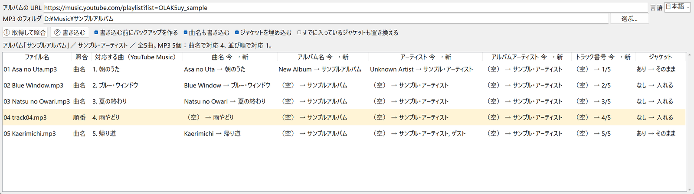

# YouTube Music タグ書き込み

YouTube Music のアルバムページの URL を貼るだけで、MP3 に曲名・アルバム名・アーティスト・トラック番号・ジャケットをまとめて書き込むアプリです。



## できること
- YouTube Music のアルバム情報を取ってきて、MP3 のタグ（ファイルに付ける曲の情報）に書き込みます
  - アルバム名
  - アーティスト
  - アルバムアーティスト（アルバム全体の名義）
  - トラック番号（「3/12」の形）
  - ジャケット画像（1200×1200）
  - 曲名（「曲名も書き込む」に印を付けたとき。ローマ字の曲名を日本語にしたいときなどに）
- ジャンルや年など、ほかのタグには触りません
- アルバム名・アーティスト名は、日本語と英語の表記から選べます
- 書き込む前に、ファイルごとに「今 → 新」を一覧で確かめられます
- フォルダ・MP3・ブラウザの URL は、画面にドラッグ＆ドロップしても入れられます

## 工夫したところ
- **自動で組み合わせる**：MP3 の曲名（タグが空ならファイル名）と、アルバムの曲名が近いもの同士を組み合わせます。日本語と英語、両方の曲名と比べるので「Come Together」と「カム・トゥゲザー」も結び付きます
- **見つからない曲も分かる**：曲名で見つからない曲は並び順で当てはめ、一覧で色を変えて知らせます。違っていたら行をダブルクリックして選び直せます
- **ジャケットは選べる**：すでに画像が入っている MP3 は、チェックを入れたときだけ差し替えます
- **元に戻せる**：書き込む前に、元のファイルを `_backup_日時` フォルダにコピーします。バックアップを切っているときは、確認画面で知らせます
- **形式を保つ**：元の MP3 のタグの形式（ID3 v2.3 / v2.4）をそのまま保ちます
- **チェックを覚える**：バックアップ・曲名・ジャケットのチェックの状態を、次に開いたときも覚えています
- **画面が固まらない**：情報の取得は別のスレッド（同時に動く別の流れ）で動かします

## 使い方
### 必要なもの
- Python 3（3.13 で確かめました）

```
pip install -r requirements.txt
```

### 起動

```
python app.py
```

1. YouTube Music でアルバムのページを開き、アドレスを「アルバムの URL」に貼ります
   - 例：`https://music.youtube.com/playlist?list=OLAK5uy_...`
2. 「選ぶ…」で MP3 が入ったフォルダを選びます
3. 「① 取得して照合」を押し、一覧で「今 → 新」を確かめます
4. 「② 書き込む」を押します

### exe にする（Windows）
[PyInstaller](https://pyinstaller.org/) を使うと、ダブルクリックで開ける exe にできます。

```
pip install pyinstaller
python -m PyInstaller --noconfirm ytmusic-tag-writer.spec
```

`dist` フォルダに `ytmusic-tag-writer.exe` ができます。

## 注意
- YouTube Music の情報は、非公式の部品 [ytmusicapi](https://github.com/sigma67/ytmusicapi) で読み取っています。Google の公式の道具ではないため、YouTube Music 側の仕組みが変わると使えなくなることがあります
- YouTube Music にはログインせず、公開されている情報を読むだけです
- アイコンはこのアプリのためのオリジナルです。YouTube Music のロゴではありません

## ファイル
- `app.py`：画面（URL とフォルダの入力、一覧、選び直し、ドラッグ＆ドロップ）
- `core.py`：YouTube Music から情報を取る、曲を組み合わせる、タグを書き込む部分
- `make_icon.py`：アイコン（`icon.ico`・`icon.png`）を作るプログラム
- `ytmusic-tag-writer.spec`：exe を作るための設定
- `requirements.txt`：必要な Python の部品
- `images/screenshot.png`：README の画面写真

## 使ったもの
- Python、tkinter、tkinterdnd2、ytmusicapi、mutagen、Pillow（アイコン作り）、PyInstaller
- Claude：1ステップずつ一緒に作り、毎回動かして確かめました
